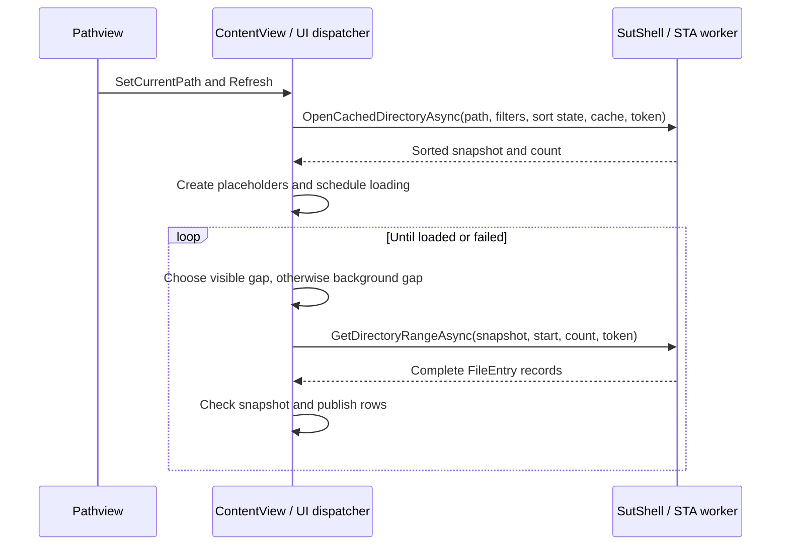

# ContentView

## Current ContentView

ContentView owns the WPF table, filter controls and settings, row placeholders,
selection, and the scheduling of directory-data requests. It passes the filter
criteria to SutShell, which applies them when preparing the directory snapshot;
ContentView does not filter the returned rows itself. Pathview owns navigation
and supplies the committed location. ContentView uses [SutShell](SUTSHELL_API.md)
for directory data, filesystem observation, and operating-system operations;
it does not embed a Shell view. The Windows-specific implementation is described
in [SutShell Windows implementation](SUTSHELL_WINDOWS.md).

The table has one row per item and columns for MT, TA1, MO, Name, an unlabeled
toggle, TA2, Size, and Date modified. The names describe the columns as follows:

| Header | Name | Content |
| --- | --- | --- |
| MT | Media type | Application-defined media category, displayed as an icon. |
| TA1 | Type and/or default app, coarse | Windows Shell base icon. |
| MO | Modifier | Windows Shell overlay icon. |
| TA2 | TypeApp2: Type and/or default app, fine | Windows Shell type description. |

TA1 and TA2 are approximate descriptions, not guarantees that either value
identifies the type or the default app. Windows can supply item-specific icons
and type descriptions, and the media type is an application-defined category.
The base icon and overlay are
shown separately; the overlay cell is empty when none is available. The current
Shell provider exposes at most one overlay per item: Windows selects one when
classical overlay handlers compete, and SutShell forwards that selected overlay
without enumerating all applicable handlers. Explorer status-column icons are
not necessarily icon overlays. The table uses a recycling
virtualized `ListView` with fixed 22-DIP
row height. Placeholder rows establish the item count and scroll extent before
complete row data is available. The DIRECTORY column shows unfiltered directory
and file counts beneath its badge; `-` indicates that a snapshot is being prepared.
The counts include items hidden by any ContentView filter and do not depend on
how many rows have loaded. At This PC, drive roots count as directories.
After a brief hover, a table row shows its full name below the row, aligned with
the name column. The tooltip can use the remaining visible table width before
long names wrap without truncation. A filename is available while row details
are still loading.

The fixed-width columns retain their widths; Name and TA2 share the remaining
table viewport. The divider after Name is draggable and changing one width
adjusts the other. The chosen TA2 width is retained when the viewport changes,
subject to the available space. Other column dividers and reordering are disabled.
The narrow, unlabeled header after Name toggles TA2, Size, and Date modified.
It shows a right-pointing triangle when they are visible and an ellipsis when
they are hidden. Hiding them gives Name the remaining width and disables its
divider. Showing them again restores their order and chosen TA2 width without
changing the rows, selection, or sort state. The VIEW controls scroll horizontally
when the available width cannot display them all. The same columns also hide
automatically when Name would be narrower than 80 DIP and reappear when enough
space is available, unless manually hidden. Clicking the ellipsis can explicitly
show them in a narrow viewport until the viewport width changes again. Automatic
hiding does not change the chosen TA2 width.

### Responsibilities

| Component | Responsibility |
| --- | --- |
| Pathview | Validates and commits navigation, supplies the current path, and coordinates refreshes from filesystem notifications. |
| ContentView | Owns one snapshot, its row placeholders and per-view SutShell sort and directory-cache state; handles column clicks, scrolling, cancellation, UI updates and refreshes. |
| SutShell | Maintains the unfiltered directory records, loaded data and sort history, prepares filtered, sorted snapshots and returns requested ranges. It does not choose ranges, monitor scrolling, or independently preload the rest. |

The background loading policy therefore belongs to ContentView. SutShell runs
each requested snapshot or range operation asynchronously on a background STA
thread; it does not run a separate prefetch loop. In the current implementation,
every call creates its own thread. Completed images are frozen so WPF can use
them on the UI thread. Cache ownership, fields, invalidation, concurrency and
freshness limitations are described in [Directory Cache](SUTSHELL_API.md#directory-cache).

### Snapshot and placeholders

1. Pathview validates the location through `EnsureLocationAccessible`, commits
  it with `SetCurrentPath`, and requests a refresh. Filter changes and filesystem
  refreshes can also start a new refresh.
2. ContentView cancels the previous snapshot and range requests, clears the
  existing rows, captures the current path and filter settings, and calls
  `SutShell.OpenCachedDirectoryAsync` with its SutShell sort and cache state.
3. SutShell reuses or enumerates all immediate children and their Shell display
  names, applies the filters, and creates a snapshot with directories before
  files and the selected sort criteria applied within each group. Missing sort
  keys are loaded as needed; previously loaded keys and entries are retained.
  This PC enumerates drive roots.
4. Once the snapshot is ready, ContentView creates one empty `DirectoryRow` per
  snapshot item, assigns the rows to the table, and schedules range loading.
  The snapshot fixes the identity and order for these indices, but does not
  freeze the filesystem: details may change or an item may disappear later.

### Sorting

`SortOrderWidget` is independent of ContentView's column enum. It accepts a list
of display names and exposes ordered `(index, direction)` pairs; indices refer
to the original input positions, including when names are duplicated. Its
`Changed` event reports configuration, direction, and order changes. ContentView
maps the indices and directions to its own SutShell sort pairs, and uses the
widget's `Select` method to synchronize table-header clicks. The widget's
`Foreground` and `Background` configure its box text and background colors;
ContentView uses the system window text and editor background colors.

Each ContentView has its own sort sequence, retained on refresh, filtering and
navigation while that view exists. The **Sort order** editor follows the Name
pattern control and always displays all six sortable columns, including hidden ones.
Its initial order is Name, MT, TA1, TA2, Date, Size, all ascending. MO is not sortable. Boxes
run from highest to lowest priority; clicking a box reverses its direction
without changing its priority. Dragging a box, or using Alt+Left/Right while it
has keyboard focus, changes its priority without changing its direction.

Clicking the primary table header reverses its direction; clicking another
header moves that column to the front with its existing direction. The editor
and the primary header triangle stay synchronized. Directories always precede
files, and both groups use the same criteria. Display name and path provide
final ascending tie-breakers. Selection is restored by path after sorting.
Applying the complete sequence requires all corresponding sort keys to be
loaded when preparing a snapshot.

### Range scheduling

`ScheduleRangeLoad` coalesces requests on the WPF dispatcher at background
priority. Layout updates, scrolling, completing a range, and loading the control
can schedule another decision. Only one range request is active per ContentView;
the scheduler waits for it to finish or observe cancellation before starting the
next. A missing virtualizing panel or a non-visible list postpones scheduling.

For each decision, `LoadNextRange`:

1. Finds realized list items that intersect the visible panel and chooses the
  lowest snapshot index whose row has neither data nor a recorded failure.
2. If no visible row needs data, advances the background cursor to the first
  remaining unloaded, non-failed row, and stops when none remain.
3. Requests a contiguous range of at most eight unloaded, non-failed rows from
  `SutShell.GetDirectoryRangeAsync`. A range beginning at a visible row may
  include rows just outside the viewport. The batch ends early at the snapshot
  boundary or an already loaded or failed row.
4. On completion, verifies that the request was not cancelled and that its
  snapshot and row array are still current. It then assigns each complete
  `FileEntry` to its placeholder on the UI thread. Property change notification
  updates all row bindings, including the separate Shell icon, overlay, and MT icon.
5. Schedules another decision. Loaded entries are also retained in SutShell's
  current-directory cache for subsequent filter and sort snapshots. When all
  rows have been loaded or marked failed, the background sequence stops.



Each returned record contains the name, path, directory flag, type, size,
modification time, Shell icon and overlay, and MT icon and name. Some fields or
icons can be empty when unavailable. No separate icon-delivery API is used.
Unloaded placeholders have a snapshot path but no `FileEntry`; selection-based
toolbar actions wait until all selected rows have loaded. The native context
menu can use snapshot paths before row details are loaded.

### Selection and inline rename

The table supports extended selection using the standard WPF selection behavior.
Each placeholder carries its snapshot path, so ContentView can retain selections
even before their full records are loaded. On refresh it restores the selected
paths in the new snapshot, including off-screen rows; paths no longer present or
excluded by the filters are dropped. Navigating to another location clears the
selection. Filesystem notifications instead reconcile the existing row collection:
unchanged rows retain their identity, a rename updates its existing row and selection,
and only affected rows are added, removed, updated or moved. When changes before the
viewport shift its first unchanged row, the logical scroll offset is adjusted to
keep that row in place. Link mark item, Copy mark item and Move mark item stage all selected paths. Name clipboard copy and Path clipboard copy
copy all selected filesystem leaf names or paths as text, one per line; file
names include their extensions. Rename requires exactly one loaded selection.
Delete operates on selected files
and folders through the Windows Shell, requests recycling, and refreshes the
view even if an operation is interrupted. Drive roots cannot be deleted. Delete
is disabled while Link, Copy or Move is prepared. Recycling availability and prompts
depend on the location and Windows settings. Right-clicking an already-selected
row preserves the selection; right-clicking an unselected row first selects only
that row. File-only, directory-only and mixed selections use the [Base and Content Menu pair](CONTEXT_MENU_SPEC.md).
Repeated right-clicks on the same row cycle through the Base Menu, Content Menu
and no menu, then restart with the Base Menu. This includes clicks while either
menu is open and the pointer stays at the opening position. A
right-click on another row while the Base Menu is open ends the series,
selects only that row and starts its applicable menu; changing the selection
also resets the series. Moving the pointer outside the Windows double-click
area around the opening point resets the series, even if the pointer returns.
An open menu remains visible; the next normal right-click on any item or the
background starts with the Base Menu. This also applies after a menu closes
while the Content Menu or no-menu step is pending. Executing a menu command
also resets the series. Shift-right-click opens the Windows menu, including on
the same row while either menu is open. For `.lnk` selections its Shell Open file
location command is replaced by the application action **Open parent**, as in the Content Menu.
That action opens the target's parent directory, including for folder targets, in the browsable Pathview and
reports an unavailable or non-filesystem target instead of launching Windows
Explorer; it is disabled for multiple selections. Right-clicking the empty
background starts its own Base/Content/no-menu sequence; Shift-right-click keeps
the original Windows background menu.

The item Content Menu starts with Shell **Open**, **Open in running app...**,
and Shell **Open with**, in that order. An unavailable Shell command has a
disabled placeholder. The running-app submenu lists
each visible matching app window as `App name - Window title`, ordered by app
and window title, with an app or window icon when available. For several selected files, an app must be registered for every
selected type. The submenu is disabled when the selection contains a directory
or no matching window is available; it is not added to background or Shift menus.
Choosing a window first attempts `Ctrl+O` and the Open dialog for each file.
If the dialog attempt fails, remaining files can be dropped at the window's
center, but not when an open dialog or a focus change makes the target unsafe.
The clipboard is not changed. A submitted dialog or accepted drop does not
confirm that a file was opened; a drop can change an existing document. No
transfer result dialog is shown. See [Open with Running App](OPEN_WITH_RUNNING_APP_SPEC.md).

### Drag and drop

Drag selected filesystem items with the left mouse button to another table,
Windows Explorer, or another compatible application. Dropping filesystem items
from an external application or another table is also supported. The **Sub
directories** list supports the same operations, dragging only the clicked folder
independently of table selection. It has no persistent, user-managed selection or
multiple selection like the table; any selection used for its menu or keyboard
interaction is temporary. Its folder rows target the corresponding folder and
its background targets the current directory. Tree views do not participate.
Dropping on a directory row targets that directory; dropping on a file row or empty table
space targets the current directory. A file row is never invoked as a drop
target. Non-filesystem data and right-button drags into the table are rejected.

The Windows Shell chooses Copy, Move or Link and provides the usual modifier-key
behavior. Drag-and-drop does not use or change the Windows clipboard or the
application's prepared Link, Copy and Move workflows. Starting a left drag
invalidates any pending context-menu sequence; ordinary right-click handling is
unchanged. Shell collision prompts, permissions and cancellation apply as usual.

Rename starts from the toolbar, `F2`, or the single-item context menu. The
inline editor uses the actual filesystem name including its extension; the
filename portion is initially selected for files. Enter or loss of keyboard
focus commits; Escape cancels. SutShell validates the name and existing-target
conflicts and delegates the rename to the Windows Shell. A failed operation
reports the error and leaves the editor active. Drive roots are not renameable
through this editor. A refresh requested during editing is deferred until the
edit ends; navigation cancels the edit. After a successful rename, the new path
is selected in the refreshed snapshot if it still passes the active filters.
Directory renames and Shell moves are also reported to Pathview so affected open
paths and histories can be updated. External rename notifications are handled
when they identify both paths; separate external delete/create events cannot be
reliably paired.

### Scroll, cancellation, and errors

- A vertical scroll cancels the active range request and schedules a new
  decision. After the old request finishes or observes cancellation, unloaded
  rows in the new visible region take priority over background work. An OS
  call already in progress cannot be interrupted and may delay that decision.
- SutShell checks cancellation between items and before returning. A cancelled
  package is discarded as a whole; partially computed entries are not published.
- A path, filter or sort refresh creates a new snapshot. Cancellation plus snapshot
  and row-array identity checks prevent an old range from populating the new
  table. A previous snapshot request is also checked before publication.
- Unloading the control cancels its active range. Loading can resume when the
  list becomes visible again; this is not a promise to prefetch hidden tabs.
- An enumeration failure is shown by `!` beneath the directory counts, with
  details in its tooltip. If a range fails unexpectedly,
  its rows are marked failed, the indicator reports that some items could not be
  loaded, and the scheduler moves on. Those rows are not retried until refresh.
  Individual unavailable metadata or icons can instead produce an entry with
  empty fields without failing the whole range.
- SutShell's directory observer is best-effort. ContentView marshals its change
  callback to the dispatcher. Known item changes are collected until the next tab
  activation; metadata is updated in the cache as notifications arrive. On
  activation, identified additions, deletions and renames update only the affected
  cached items, and the filtered, sorted snapshot is reconciled with existing rows.
  The parent directory is not re-enumerated for those events. Unknown notifications,
  watcher errors, and detected changes while observation is suspended fall back
  to a full refresh. Tree nodes can still require their own directory enumeration.
  Explicit refresh, successful rename, copy or move, and navigation also invalidate it. Filter and
  sort changes do not. Notifications and snapshots do not guarantee an atomic
  filesystem view; Shell icon or overlay changes may not generate notifications.

The focused checks in [SutShell.Tests.ps1](tests/SutShell.Tests.ps1) exercise
snapshot ranges, cancellation, missing files, background completion without
scrolling, visible-row priority, scrolling, rapid navigation, and Shell icon
rendering in the BROWSE startup path. They also cover multiple-selection
restoration and Link/Copy/Move staging, the multi-item Shell menu, inline rename
entry points, commit/cancel, validation, folder-rename notification, cached
filter/sort reuse, invalidation, MT enum ordering and both Shell icon columns.

## Historical Shell-Host Reference

Everything below this heading describes the previous Shell-host/private-table
implementation and is retained for historical reference, not as the current
ContentView interface or runtime behavior.

## Historical Scope and Relationship

`ContentView` is the content component of one Pathview. Its XAML and code-behind
live in [ContentView.xaml](./ContentView.xaml) and
[ContentView.xaml.cs](./ContentView.xaml.cs). It owns the content filter and
operation rows, the private spike table, and the hosted Shell view. The Shell
host is private to the component; callers do not access it directly.

The [behavior specification](./SHELL_EXPLORER_BEHAVIOR_SPEC.md) remains the
authority for application-visible requirements and acceptance checks. The
[application architecture](./SHELL_EXPLORER_ARCHITECTURE.md) describes how
Pathviews, navigation, trees, tabs, and content views work together. This
document describes the component boundary and its current implementation.

## Historical Behavior

Each ContentView presents the current directory's Shell content and the
adjacent experimental private column. The Shell remains authoritative for
items, their order, selection, and native commands; the private table shows
the media type of each displayed filesystem item and follows Shell scrolling.
The table and scroll-alignment measurements are a spike, not a replacement
for the Shell view.

The private column remains enabled and normally rendered, but its rows do not
show hover or retain an independent selection. It cannot be scrolled
independently. Scroll and select items in the Shell view; input over the
private column is not forwarded to the Shell.

When a different location is requested, the private column is cleared
immediately instead of continuing to show rows from the previous directory.
The Shell view and committed Pathview location remain Shell- and
navigation-controlled. After a successful navigation, the private column
shows the new view's available filesystem items and can update again as more
items appear; it does not wait for the entire folder to finish loading. If
navigation fails, the current location remains unchanged and the column is
repopulated from the retained Shell view.

The **VIEW** and **FOR SELECTED** rows are above the table; the area above the
DIRECTORY column is empty. The **VIEW** row controls the content's **Hide directories**, **Hide internal**,
and **Name pattern** filters. These settings are local to the Pathview; the
content **Hide internal** setting is independent of the tree filters. When a
fixed Pathview navigates to BROWSE, including by double-clicking a directory
in its content table, all three content filters and the complete sort order,
including priorities and directions, are copied to BROWSE. If an existing
fixed tab matches the destination, that tab is selected without overwriting
its settings. **Pin** copies the same content settings from BROWSE to the new
or existing fixed tab.
Later changes remain local to each Pathview. **Reset** at the end of the **VIEW** row
restores both hide filters to on, clears the name pattern, and restores the
initial sort order and ascending directions. The table refreshes once after all
settings are applied; tree filters and other Pathviews are unchanged. The
**DIRECTORY** column to the left of the table offers New, Item clipboard paste and Link/Copy/Move abort and execute. New opens a
dialog to choose a type and name before creating the item in the current
filesystem directory. It is disabled for virtual or unavailable locations.
The background Content Menu opens the same dialog. The **FOR SELECTED** row offers
Properties, Name clipboard copy, Path clipboard copy, Item clipboard copy, Link mark item, Copy mark item, Move mark item, Rename, and Delete. Properties opens
the Windows Shell properties for one or more loaded selected items. Button availability
depends on the local selection and on the shared transfer state.

The dialog presents types in a fixed-height, scrollable list with Shell type
icons. Directory and Textfile appear first, separated from the other available
types by a line; Textfile is initially selected. Clicking a type returns keyboard focus to the name editor.
After creation, the item is selected and brought into view in the current
ContentView. Filters that would hide it are cleared; cancelling the dialog
leaves the filters unchanged.

New supports folders and directly creatable ShellNew registrations: empty
files, binary data and available file templates. A plain text type is also
available when not registered. Command-based, unsupported or unavailable
templates are not offered as direct types. The separate **More types via
Windows** action opens the original Shell New submenu, where Windows or an
extension chooses the name and may display its own wizard. Shift-right-click
also retains the native background menu. The list depends on registrations and
available templates; it is not guaranteed to match every Windows New entry.

The selected type proposes an extension. Switching types replaces an unchanged
proposed extension; a manually changed extension is preserved and requires
confirmation if it differs from the selected type. Invalid or reserved names
and existing destinations are rejected. Cancelling creates nothing, and
creation never overwrites an existing item.

### Link, Copy and Move across ContentViews

Link, Copy and Move are logically content operations, but their prepared states are
shared application-wide, not stored in a ContentView instance. A user can
mark source paths in one tab and execute into the current directory of another
tab. A prepared operation enables its own execute and abort actions and disables
the other transfer groups. Link execute creates `.lnk` files pointing to the
selected sources without changing them. Its names use ` - Shortcut` and a
number when necessary to avoid overwriting existing items. Abort clears the prepared paths; a
successful execute clears them after the operation returns. Selection and filter
settings remain local to each view.

New and application-owned Link/Copy/Move operations finish through the same ContentView
operation, `RevealInsertedItems`. It disables Hide directories for inserted
directories, disables Hide internal for inserted internal items, and clears the
name pattern if any inserted item does not match. Other filters and other views
are unchanged. It selects all inserted items in the current directory and
scrolls the first into view. Copy and Move use actual destination names reported
by the Shell, and Link reports the shortcut names it creates; items already transferred are handled even if
a later item fails. Native Shell menu and extension operations remain
Shell-owned and do not use this completion.

Marking stores paths, not handles or reservations. Execute performs preflight
checks, but paths and permissions can change afterward; a multi-item operation
is not atomic and can partially complete before a later error. Failed preflight
does not start a transfer and leaves the staged state available. See the
[behavior specification](./SHELL_EXPLORER_BEHAVIOR_SPEC.md#content-listing)
for the full rules, error behavior, and acceptance criteria.

The app-owned workflows do not use or change the Shell clipboard. Item clipboard copy
copies the selected filesystem items to the clipboard; Item clipboard paste copies
eligible clipboard items to the current directory. Cut, Link and clipboard data
without an identifiable supported Copy effect are rejected without changing the
source or clipboard. A Copy effect that also permits Link is accepted, but only
a copy is performed.
Item clipboard copy is in the same selection-row group as Name and Path clipboard copy;
Item clipboard paste is in the DIRECTORY column before the Link group. Item clipboard paste is enabled for supported filesystem Copy data
and an existing destination directory. These clipboard actions and
external clipboard operations do not alter any prepared workflow.

## Historical Interface to Pathview

These members are the current internal component API, not a separate C#
interface. The enclosing Pathview owns navigation history and success-gated
location/tree updates.

| Member | Contract |
| --- | --- |
| `Initialize(isBrowsable)` | Called once after construction. Configures the content's browsable/fixed role and creates the Shell host in the default mode. A second call throws. |
| `UsesSynchronousNavigation` | Indicates the retained legacy WPF mode. Pathview validates and commits that mode's directory navigation itself. |
| `FocusContent()` | Requests keyboard focus in the native Shell content, or in the file list in legacy mode. Returns whether the request could be made. |
| `NavigateTo(path)` | Clears the private column and requests Shell-backed navigation; it does not commit the Pathview location. It throws if asynchronous content navigation is unavailable. |
| `NavigationCompleted(path)` / `NavigationFailed(path)` | Report Shell navigation outcomes. Pathview handles pending requests and commits its location/history only on success; a failure path may be empty. |
| `DirectoryOpenRequested(path)` | Reports a directory activation for Pathview to route according to its browsable/fixed role. |
| `SetCurrentPath(path)` | Supplies the location committed by Pathview. It neither navigates nor refreshes the content by itself. |
| `HideInternalItems` | Gets or sets this view's nullable content **Hide internal** checkbox state. The other content filters are currently controlled by the view's own UI. |
| `Refresh(refreshView)` / `RefreshStatus()` | Refresh content or its status as requested. In Shell mode, status refresh also schedules private-table repopulation. |
| `SetObservedDirectories(paths)` / `ClearObservedDirectories()` | Pass or clear the directory-notification routes calculated by Pathview. |
| `FileSystemChanged` | Reports the observed directory and the filesystem event, including old and new paths for a direct rename; a watcher error has no filesystem event. Immediate changes inside a child directory are reported as a metadata change to that child. |

`PrivateTableTopGapOffset` is a WPF binding property for the spike's visual
alignment, not a navigation or Shell API. The action buttons do not expose
the Shell host: ContentView handles them and uses the shared workflow state.

## Historical Implementation

### Component ownership and lifetime

`Initialize` creates one `ShellExplorerBrowserHost` in the default Shell mode
and forwards its navigation, folder-open, and filesystem events. ContentView
attaches the 30-ms scroll timer and workflow/selection notifications when
loaded; on unload it stops the scroll timer and detaches those subscriptions.
Pathview owns calculation and clearing of notification routes and retains its
separate filesystem-refresh timer. The host manages its native window, Shell
view change monitor, and COM lifetime.

The retained `UseLegacyWpfFileList` switch is in `ContentView.xaml.cs`:
`false` selects the Shell view and private spike table; `true` selects the
legacy WPF list. The legacy mode has synchronous navigation controlled by
Pathview and does not create the Shell host.

Frame brushes/thickness, content button style, and the Shell icon template are
defined once in [App.xaml](./App.xaml) and reused by ContentView and Pathview.
The virtual This PC path is shared through `ShellLocations`; it is not a
filesystem path.

### Private table and scroll synchronization

In Shell mode, a single light-gray `ViewFrameBrush` / `ViewFrameThickness`
border surrounds a two-column grid containing both the private table and the
Shell host. Neither child has a separate WPF border. The shared frame is
collapsed with the Shell view when the legacy WPF list is active.

#### Media type and icon mapping

The private column is headed `MT` and is 16 DIP wide, with an 8-DIP space
between it and the shared frame on the left. Each mapped item shows one
16-by-16 DIP icon instead of the media type name.

Directories are classified first, followed by `.lnk` and `.url` files. For all other
files, the extension is matched case-insensitively against the manually
maintained [media-types.json](./Assets/media-types.json), which is the source
of the media type names and extension mapping. No match or no extension
displays an empty cell. Repeating an extension for the same type does not make
it ambiguous. The media type name remains available as the row's accessibility
name.

The supported media types are fixed by the internal `MediaType` enum. Their
names below are the exact identifiers used in the JSON; the second mapping
assigns each type one of the existing 16-by-16 assets:

| Media type | Icon asset |
| --- | --- |
| `executable` | [type_exe 16.png](./Assets/type_exe%2016.png) |
| `lines-text` | [type_lines_text 16.png](./Assets/type_lines_text%2016.png) |
| `book` | [type_book 16.png](./Assets/type_book%2016.png) |
| `structured-data` | [type_structured_data 16.png](./Assets/type_structured_data%2016.png) |
| `image` | [type_image 16.png](./Assets/type_image%2016.png) |
| `audio` | [type_audio 16.png](./Assets/type_audio%2016.png) |
| `video` | [type_video 16.png](./Assets/type_video%2016.png) |
| `box` | [type_box 16.png](./Assets/type_box%2016.png) |
| `command-data` | [type_command_data 16.png](./Assets/type_command_data%2016.png) |

The enum also contains these special types, which do not need entries in the
JSON mapping:

| Special type | Meaning | Icon |
| --- | --- | --- |
| `directory` | A filesystem directory, including a directory junction. | Windows standard folder icon. |
| `shell-link` | A `.lnk` file, including a shortcut to a directory. | [type_shell_link 16.png](./Assets/type_shell_link%2016.png). |
| `url` | A `.url` file, providing a link to an internet resource. | [type_url 16.png](./Assets/type_url%2016.png). |
| `ambiguous` | A file extension mapped to different media type names. | Warning triangle. |
| `None` (internal only) | No extension or no matching media type. | None; the cell is empty. |

The warning triangle is drawn in the application. Icons are loaded once and
shared across rows.

The JSON is embedded in the application at build time and is loaded once per
process. Changes to the source file require a new build. The JSON is maintained
manually and must never be modified autonomously by the application, tooling,
or an AI assistant. An AI assistant may edit it only when the user explicitly
requests that change; adding types, resolving conflicts, or formatting it are
not implicit permission to edit the file. A missing or malformed embedded
mapping or an unsupported JSON media type is an error, not an empty mapping.
Introducing a new media type requires updating the enum and icon mapping as
well as the JSON.

#### Navigation and refresh lifecycle

1. `ContentView.NavigateTo` records the pending destination and clears
   `PrivateFileTable.ItemsSource` before calling the host. It also invalidates
   the last synchronized scroll offset and restores the initial top-gap
   offset. For navigation initiated inside the Shell, the host's internal
   `NavigationStarting` event performs the same clearing when
   `IExplorerBrowserEvents.OnNavigationPending` accepts the request.
   `NavigationStarting` is internal to the component, not a Pathview event.
   A fixed view rejects disallowed Shell navigation before raising it, so its
   private column is not cleared for that rejected request.
2. While a destination is pending, queued private-table refreshes do not query
   or repopulate the table. On a matching completion or failure, or if either
   pending or reported path is empty, the pending state is cleared and a
   refresh is scheduled. Nonempty paths are compared case-insensitively;
   a nonmatching outcome does not end the newer pending state. A synchronous
   exception from `NavigateTo` also ends that request, schedules a refresh,
   and is rethrown.
3. `OnNavigationComplete` causes the host to reset its cached item count and
   sized width, normalize the Shell view, and dispatch `NavigationCompleted`
   at `DispatcherPriority.DataBind`. `OnNavigationFailed` dispatches
   `NavigationFailed` at the same priority. ContentView ends its pending state
   before forwarding the outcome to Pathview. Pathview still commits its
   location and history only on success. A synchronous browse failure can
   also report `NavigationFailed` directly.
4. Navigation outcomes, filter changes, filesystem refreshes, reloading the
   control, and the item-count event described below schedule a private-table
   refresh at `DispatcherPriority.Background`. Duplicate pending requests are
   coalesced. A queued refresh is skipped if the control is unloaded or
   navigation is pending; a later load or navigation outcome schedules
   another. `GetDisplayedFileSystemItems` obtains the number of items through
   `IFolderView::ItemCount(SVGIO_ALLVIEW)` and retrieves each item by its
   view index with `IFolderView2::GetItem`. Filesystem items are resolved with
   `IShellItem::GetDisplayName(SIGDN_FILESYSPATH)` and classified using Shell
   item attributes and the mapping above; non-filesystem items are skipped.
   For an item the Shell identifies as both a folder and a stream or link,
   filesystem attributes distinguish a directory junction from a file such as
   a directory shortcut or compressed archive. The refresh does not enumerate
   the directory independently. COM, filesystem and invalid-operation
   exceptions are written to debug output.
   Each row retains its path as an identity as well as its displayed media
   type, so equal media type values remain distinct rows. If the ordered paths
   and media types have not changed, the existing WPF `ItemsSource` is retained.
   Replacing it unnecessarily can itself cause further Shell accessibility
   reorder notifications, producing a refresh loop.

#### Shell view and layout events

Navigation completion does not guarantee that the Shell has finished
populating or laying out its view. In particular, a first item query can be
empty and a vertical scrollbar can appear later. The host therefore creates a
[`ShellViewChangeMonitor`](./ShellViewChangeMonitor.cs) for its native host
window. It installs two out-of-context `SetWinEventHook` subscriptions scoped
to the current process and filters callbacks to descendant HWNDs of that host:

| Native event | Value | Filter and reaction |
| --- | --- | --- |
| `EVENT_OBJECT_CREATE` | `0x8000` | For `DirectUIHWND` with a positive object ID, flag a possible item change; for a `ScrollBar` with object ID `0`, flag a possible layout change. |
| `EVENT_OBJECT_DESTROY` | `0x8001` | Same filters and reactions, when the HWND still passes the descendant check. |
| `EVENT_OBJECT_SHOW` | `0x8002` | Same filters and reactions. |
| `EVENT_OBJECT_HIDE` | `0x8003` | Same filters and reactions. |
| `EVENT_OBJECT_REORDER` | `0x8004` | For `DirectUIHWND` with any object ID, flag an item reorder; for a `ScrollBar` with object ID `0`, flag a possible layout change. |
| `EVENT_OBJECT_LOCATIONCHANGE` | `0x800B` | For a `ScrollBar` with object ID `0`, flag a possible layout change; DirectUI location changes are ignored. |

These are Windows accessibility notifications, not a Shell enumeration-complete
callback. The monitor coalesces item, reorder, and layout flags into one
`DispatcherPriority.ContextIdle` operation. A DirectUI reorder always raises
the host's internal `DisplayedItemsChanged` event and schedules a refresh,
regardless of the number of items. For other item flags, the host queries the
current `IFolderView2` through `IFolderView::ItemCount(SVGIO_ALLVIEW)` and
raises the event only if the count differs from its cached value. If both flags
arrive together, the host raises the event once and still updates the cached
count. For a layout flag, the host remeasures the current Shell view's usable
client width and recalculates the Name column only when that width differs from
the last successfully sized width.

This is incremental rather than a fixed-delay or enumeration-complete strategy.
The observed `DirectUIHWND` class and positive accessible object IDs are not a
documented Shell enumeration contract; other Windows versions and providers
need runtime verification. Except for reorder, an item notification with an
unchanged count does not itself refresh the table, so it cannot by itself
detect every same-count replacement. Receipt of a reorder notification after
every possible Shell sort is not guaranteed by this implementation.
Filter changes and filesystem notifications have
their own refresh routes: filter handlers refresh the Shell and status; the
host forwards `SHChangeNotifyRegister` notifications as `FileSystemChanged`
to Pathview, which coordinates its deferred refresh.

`ShellBrowserSite` also handles `ICommDlgBrowser.OnStateChange` with
`CDBOSC_RENAME` (`0x00000003`) by raising `DisplayedItemsChanged` independently
of the item-count check. ContentView then schedules the same Shell-backed
table refresh. This is a targeted rename notification, not a general
view-changed event; whether the hosted Shell sends it at the right time for a
particular rename remains to be verified in use. With column sizing tracing
enabled, the host logs when this callback occurs.

The monitor's hooks are removed before the host window and browser are
destroyed. Hook installation failures raise `Win32Exception`; item-count query
failures are written to debug output. Neither the item refresh nor the
scrollbar-width update uses a delay timer. The separate scroll-position
synchronization still uses the existing 30-ms timer described below.

#### Sorting and reorder investigation

The Shell owns header interaction and sorting; the accessibility hook observes
notifications and does not consume header input. In a disposable three-file
folder, a mouse message sent to the native Name header changed the Shell
order. Accessibility-invoked Name, Size, and Date modified sorting was also
checked in both directions. The private order matched the Shell after each
tested sort, and an external rename and name-pattern filter were checked.
The user subsequently confirmed that the result looked good in manual use.
These observations do not establish which condition caused the originally
reported unresponsive header, nor do they guarantee notifications for every
Shell provider or sort.

Two problems were found while investigating:

- Reading `SVGIO_ALLVIEW` through `IShellView::GetItemObject` and
  `IDataObject`/`CF_HDROP` did not reliably return the visible sort order.
    The private table now reads items by `IFolderView2::GetItem` view index,
  as described above. The selection and file-operation paths are separate.
- Unconditionally replacing the private table's `ItemsSource` after every
  reorder produced further DirectUI reorder notifications, followed by more
  refreshes even when idle. Each coalesced reorder batch still schedules a
  Shell-backed synchronization, but the table is replaced only if the
  resulting ordered rows differ. In the controlled test, idle notifications
  then settled instead of continuing, including after sorting and filtering.

#### Scroll synchronization

The Shell view is DirectUI, so the spike polls its vertical scrollbar child
using `GetScrollInfo`, not `LVM_*` or `GetVisibleItem`. The observed range is
item count times 100. Every 30 ms, the table computes
`rowsScrolled = position * itemCount / total` and scrolls its pixel-virtualized
WPF viewer by `rowsScrolled * rowPitch`. The pitch is measured between the first
two realized rows and cached; a single-row fallback is not cached.

The private table remains enabled; its row containers are excluded from hit
testing and keyboard focus so they do not show hover or receive mouse
selection. A `SelectionChanged` handler clears any independent selection,
including selection requested through accessibility. The table consumes
preview mouse-wheel events and the arrow, Page Up, Page Down, Home, and End
keys. Touch panning and text search are disabled, the scrollbars are hidden,
and the table handles `RequestBringIntoView`. A `ScrollChanged` handler restores
the last Shell-derived offset if another action moves the private viewport.
Programmatic `ScrollToVerticalOffset` calls from the Shell synchronization
remain enabled.

The private header is 25 DIP high. A render-only 6-DIP row translation decreases
to zero over the first Shell row, approximating the Shell's initial gap without
changing virtualized item sizes or scroll extent. This is empirically derived,
not a documented Shell metric. At 96 DPI, the latest measured alignment was
0 px from the top through the middle and 1 px at the end; other DPI settings
and Windows versions remain untested. See the
[scroll-sync handoff](./SCROLL_SYNC_HANDOFF.md) for measurements and history.

The visible delay between Shell rows and the private column is an open
investigation; see [private column population latency](./CONTENT_VIEW_POPULATION_LATENCY.md)
for the current hypotheses and measurement plan.

### Transfer and selection implementation

`LinkWorkflowState.Shared`, `CopyWorkflowState.Shared` and `MoveWorkflowState.Shared` hold distinct prepared
path arrays and raise change events. Loaded ContentViews subscribe and update
their button states; they do not own those shared states. `ShellFileOperations`
checks destination and source attributes. Copy and Move resolve all source Shell items
before queuing native `IFileOperation`; Link uses `IShellLink` and `IPersistFile`.
The control reports
operation errors and clears the prepared state only after the operation
returns successfully. Preflight cannot prevent subsequent changes and no
rollback is performed after a partial transfer.

Toolbar and Base Menu Item clipboard copy invoke the Shell Copy verb. Item clipboard
paste validates the clipboard's file paths and preferred drop effect again at
execution, then explicitly copies the captured paths using `IFileOperation`.
It does not invoke the Shell Paste verb. Clipboard changes update Item clipboard
paste availability but do not prepare, cancel, or replace internal transfers.

Rename is enabled for exactly one selected filesystem item and starts the
Shell inline editor. Do not invoke the selection `IContextMenu` with the
canonical `rename` verb: that implementation returned `E_NOTIMPL`. Instead,
the implementation obtains `SVGIO_SELECTION` as an `IDataObject`, reads its
Shell IDList Array as `TYMED_HGLOBAL`, and calls `IShellView.SelectItem` with
the single relative child PIDL and `SVSI_EDIT` (`0x0003`). The medium remains
locked during that call; the medium and managed/raw COM references are
released in `finally`. The Shell owns validation, commit/cancel, and
name-collision behavior. Name clipboard copy uses the filesystem leaf name; Path clipboard copy uses the
selected filesystem path; Delete and native Shell context-menu operations remain
selection-aware.

### Shell View Host

`ShellExplorerBrowserHost` creates a child host window with `CreateWindowExW`,
activates the Shell's `CLSID_ExplorerBrowser` through `CoCreateInstance`, and
hosts it on the WPF UI's STA thread.

Initialization sequence:

1. Create the child HWND in `HwndHost.BuildWindowCore` and install the Shell
   view change monitor.
2. Create the `IExplorerBrowser` COM object.
3. Create and attach `ShellBrowserSite` with `IObjectWithSite.SetSite`.
4. Initialize in Details mode with `FOLDERSETTINGS`; do not enable
   `EBO_SHOWFRAMES`, so the Shell navigation pane/frame is not shown.
5. Subscribe to `IExplorerBrowserEvents` using `Advise`.
6. Defer the first `BrowseToIDList` until `DispatcherPriority.Loaded`.
7. On navigation completion, capture the active `IFolderView2` sort columns,
   set Details mode and `FWF_NOGROUPING`, replace the visible columns with
   Name, Type, Size, and Date modified in that order, then restore the captured
   sort. Folder-specific grouping, view mode, and columns are not used; then
   recalculate the Name width for the new view.
8. Update the Shell view's bounds with `SetRect` when the WPF host is resized,
   then use `IColumnManager` to size the visible Name column to the remaining
   width.
9. On teardown, remove the change-monitor hooks, `Unadvise`, call `Destroy`,
   clear the site, release COM references, and destroy the child HWND.

Navigation uses `SHParseDisplayName` to obtain an absolute PIDL and
`IExplorerBrowser.BrowseToIDList`; the allocated PIDL is freed after the call.
`IExplorerBrowserEvents.OnNavigationPending` updates the filter's current path
before item enumeration. `OnNavigationComplete` converts the PIDL with
`SHGetNameFromIDList(SIGDN_FILESYSPATH)`, then dispatches the path update to WPF
so the active path, trees, tab title, status, and address choices synchronize.
Shell-backed navigation does not commit `CurrentPath` or history when the
browse is requested; those values and displays change only after
`OnNavigationComplete`. `OnNavigationFailed` restores the filter to the last
completed path, leaving the active location and history unchanged.
The virtual This PC root is a handled exception; other non-filesystem
namespace locations do not become filesystem paths and are not fully integrated
with the custom trees yet.

For a non-browsable Pathview, single-clicking a directory in the Active path tree
or Sub directories list raises an explicit open request instead of
navigating that Pathview. The Shell view routes its default open command through
`ICommDlgBrowser.OnDefaultCommand`; the host reads the selected filesystem path
and accepts the command only for a directory or a `.lnk` resolving to a
directory. If Shell navigation for a folder or folder shortcut reaches
`OnNavigationPending`, the fixed host still returns `E_ABORT`, but first
resolves a filesystem folder target and raises the same open request. Pathview
forwards this to `MainWindow.NavigateWithHistory`, which selects an existing
matching fixed tab when available; otherwise it navigates the browsable
Pathview and commits its path and history only when its Shell view confirms
success. The source fixed Pathview's location and state are not changed.

The initial browse must not run synchronously inside `BuildWindowCore`.
`BrowseToIDList` can pump Windows messages; doing so during WPF's initial layout
caused a dispatcher exception and prevented startup. Deferring the browse
avoids that reentrancy.

### Shell keyboard routing

The ExplorerBrowser spike verified context-menu New, context-menu Copy/Paste,
Paste shortcut, clipboard interoperability with Windows Explorer, and
right-button drag/drop. Its initial Ctrl+C/Ctrl+V keyboard test failed. The
host now overrides `HwndHost.TranslateAcceleratorCore` and forwards messages to
the current view's `IInputObject.TranslateAcceleratorIO`; if that returns
`S_FALSE`, it falls back to `IShellView.TranslateAccelerator`. Runtime tests
with disposable files verified Ctrl+A selection, Ctrl+C copy, Ctrl+V paste,
Ctrl+X cut, and Ctrl+Z undo. The Shell-hosted view remains responsible for
common file operations; do not duplicate these as custom file-copy code.

### Shell Details Column Sizing

#### Expected behavior

The WPF content pane occupies the remaining width after the sidebar. The hosted
ExplorerBrowser view must follow that pane on both window resize and sidebar
splitter movement. In Details mode, the visible non-Name columns retain their
Shell-provided widths and Name uses the remaining width. The standard column
order is Name, Type, Size, and Date modified; the Shell's Size column provides
the KB-formatted value. The resulting view
must have no horizontal scroll range at the tested layout sizes. Unchecking **Hide directories** can create or remove a vertical Shell scrollbar
without changing the WPF pane size, so that refresh also requires a width
recalculation.

`ContentView.ShellBrowserSlot_SizeChanged` converts the WPF size to physical
pixels and calls `ShellExplorerBrowserHost.SetViewSize`. The host applies those
bounds through `IExplorerBrowser.SetRect`. `OnWindowPositionChanged` is also
retained as a native-host fallback. After a successful `SetRect`, the host
queries the current view for `IColumnManager`, enumerates visible columns, and
uses `PKEY_ItemNameDisplay` (`{B725F130-47EF-101A-A5F1-02608C9EEBAC}`, PID 10)
to identify Name. The target width is:

`UsableShellViewWidth = ShellViewClientWidth - VisibleVerticalScrollBarWidth`

`NameWidth = max(80, UsableShellViewWidth - OtherVisibleColumnWidths - 11)`

The other widths are read with `GetColumnInfo`; the Name width is applied with
`SetColumnInfo`. The width is recalculated after Shell navigation because the
Shell may replace the current view. The host also observes its Shell scrollbar
window's accessibility and location events and recalculates Name if the usable
view width changed. This covers a vertical scrollbar appearing or disappearing
after navigation or filtering, without a delayed sizing timer.
`IColumnManager` widths are physical pixels. Its COM method declarations
must follow the SDK vtable order (`SetColumnInfo`,
`GetColumnInfo`, `GetColumnCount`, `GetColumns`, `SetColumns`); a different
declaration order dispatches calls to the wrong native methods.

#### Measured behavior

The first implementation sized columns using the outer host width. HWND
inspection showed the host was 1202px wide while the ExplorerBrowser child and
Shell view were 1200px wide, a 2px difference at the tested window size. The
code now gets the current `IShellView` window and uses its `GetClientRect`
width, rather than assuming the HwndHost width is the Shell's usable width.

Using the Shell client width alone still left a small horizontal scroll range.
The Shell's `IColumnManager` reports column widths, but does not expose the
view's complete horizontal content extent or a documented trailing-inset
value. Runtime UI Automation on the Shell `DirectUIHWND` showed that an 8px
allowance still left a small range (the view reported about 99.886% visible at
an 880px client width). An 11px allowance made `HorizontallyScrollable` false
and hid the Shell scrollbar at both the 880px startup view and the 1200px
resized view. The host widths in those checks were 882px and 1202px
respectively. A window-width increase also produced a matching `SetRect` and
Name-width update.

Unchecking **Hide directories** in a folder with enough entries to show the
vertical bar left the Shell view 880px wide, but its visible vertical scrollbar
was 17px wide, reducing usable width to 863px. The then-delayed recalculation
reduced Name from 525px to 508px; Size stayed at its Shell-provided 80px, and
UI Automation reported `HorizontallyScrollable = false`. The horizontal bar
had appeared because the Shell's vertical bar consumed width without raising a
WPF resize event.

The 11px value is therefore an empirically derived Shell-specific allowance,
not a documented Windows border metric. It was verified on this Windows build
and at these two widths; different Windows versions, DPI settings, or column
sets may require revalidation. `SUTWINEXPLORER_TRACE_COLUMNS=1` enables an
opt-in per-process trace in `%TEMP%` named
`SUTWinExplorer-column-sizing-<pid>.log`; it records WPF/native sizes, COM
results, and computed widths.

### Hide Directories Filter

The **Hide directories** checkbox is WPF-owned and defaults to checked, which
preserves the default-hidden directory behavior. The positive internal
`_showDirectories` value is set to the inverse of the checkbox. The filter is
implemented at the Shell view boundary, so the Shell still owns enumeration,
icons, menus, and file operations.

#### Service registration

`ShellBrowserSite` is a managed COM-visible object implementing `IServiceProvider`
and `ICommDlgBrowser`. `IExplorerBrowser` is given this site through
`IObjectWithSite.SetSite`.

`IServiceProvider.QueryService` recognizes `SID_SExplorerBrowserFrame` with
`IID_ICommDlgBrowser` and returns the site's COM interface pointer. The Shell
then calls `ICommDlgBrowser.IncludeObject` for candidate child items.

The callback interfaces must be managed COM-callable interfaces (`ComVisible`),
not `[ComImport]` interfaces. Initially the callback was never useful because
the site did not expose the service correctly; runtime tracing confirmed that
service requests and `IncludeObject` calls were occurring after the COM
visibility correction.

#### Content item filtering

The **Name pattern** editor, when nonblank, requires the item's Shell display
name (or filesystem leaf name if unavailable) to match its wildcard expression.
When **Hide directories** is checked,
`IncludeObject` excludes items classified as folders. The separate content
**Hide internal** checkbox excludes items matching its rules. If the pattern is
blank and neither hide filter is active, `IncludeObject` returns `S_OK` for
every item. Otherwise it:

The exclusion rules combine with OR: an item is excluded if any enabled rule
matches. Inclusion is the AND of passing each enabled filter:

```text
hideByName = name starts with "." or "$"
hideBySystemAccess = isSystem and accessDenied
patternMatches = pattern is blank or wildcard-matches the display name
exclude = not patternMatches
  or (hideDirectories and isDirectory)
  or (hideInternal and (hideByName or hideBySystemAccess))
include = patternMatches and not (hideDirectories and isDirectory)
  and not (hideInternal and (hideByName or hideBySystemAccess))
```

Equivalently, inclusion requires all of these conditions:

```text
(patternMatches)
and (not hideDirectories or not isDirectory)
and (not hideInternal or
  (not hideByName and (not isSystem or accessAllowed)))
```

For a file, `accessDenied` means it cannot be opened for reading; for a
directory, it means its entries cannot be listed. `isSystem` alone does not
exclude an item. Junction status is not part of either rule.

1. Reads the current folder path supplied by the `ShellExplorerBrowserHost`.
   `OnNavigationPending` updates this path before the destination view
   enumerates items.
2. Binds that path to an `IShellFolder`: `SHParseDisplayName` creates the
   absolute PIDL, `SHBindToParent` provides the parent and relative child PIDL,
   and `IShellFolder.BindToObject` obtains the current folder. The bound folder
   interface is cached by path and released when the path changes or the view
   is destroyed.
3. Places the callback's borrowed child PIDL into a one-element pointer array
   and calls `IShellFolder.GetAttributesOf` with `SFGAO_FOLDER`.
4. Returns `S_FALSE` for folder items when **Hide directories** is checked.
5. When the pattern is nonblank or content **Hide internal** is checked, gets
  the child item's parsing name and combines it with the current path. It
  rejects names that do not match the pattern, then evaluates the shared
  `InternalItemFilter` predicate when **Hide internal** is checked. Dot- and
  dollar-prefixed names are excluded. A System item is excluded only when
  opening a file for read or listing a directory returns access-denied.

The child PIDL passed to `IncludeObject` is borrowed and is not freed. The child
PIDL returned by `SHBindToParent` points into the absolute PIDL allocation and
is also not freed separately. Only the pointer array allocated for
`GetAttributesOf` and the absolute PIDL allocation are freed by this code.
Folder-query and name-resolution failures fail open (`S_OK`) rather than
accidentally hiding ordinary files. Access-denied is the only I/O failure used
to exclude a System item; other I/O failures remain visible.

Directory reparse points follow the same folder and internal-item rules when
the Shell reports `SFGAO_FOLDER`; junction status alone is not a filter
condition. Runtime testing verified ordinary directories; junction/reparse-
point coverage remains a dedicated acceptance test.

When either content checkbox changes, `ShellExplorerBrowserHost` updates the
site state, obtains the current `IShellView` through
`IExplorerBrowser.GetCurrentView`, and calls `IShellView.Refresh` to re-enumerate
the active folder without navigation. `SetShowDirectories` receives the
positive value derived from the inverse of **Hide directories**.

#### Filter debugging findings

- `IShellFolder.GetUIObjectOf` does not support `cidl == 0`; use
  `IShellView.GetItemObject(SVGIO_BACKGROUND, ...)` for folder-background
  menus. That is separate from the directory-filter callback.
- Trying to obtain the current folder with
  `IShellView.GetItemObject(SVGIO_BACKGROUND, IID_IShellFolder)` returned
  `E_NOINTERFACE`. The working filter instead binds the current path through
  `SHParseDisplayName`, `SHBindToParent`, and `BindToObject`.
- A temporary trace confirmed that `QueryService` and `IncludeObject` were
  reached. The trace was removed after fixing folder binding.
- Runtime UI Automation on the default use case observed 23 file rows with
  **Hide directories** checked, 28 rows when unchecked, and 23 again when
  checked. This proves
  live checkbox refresh in that folder; it is not a complete reparse-point
  test.
